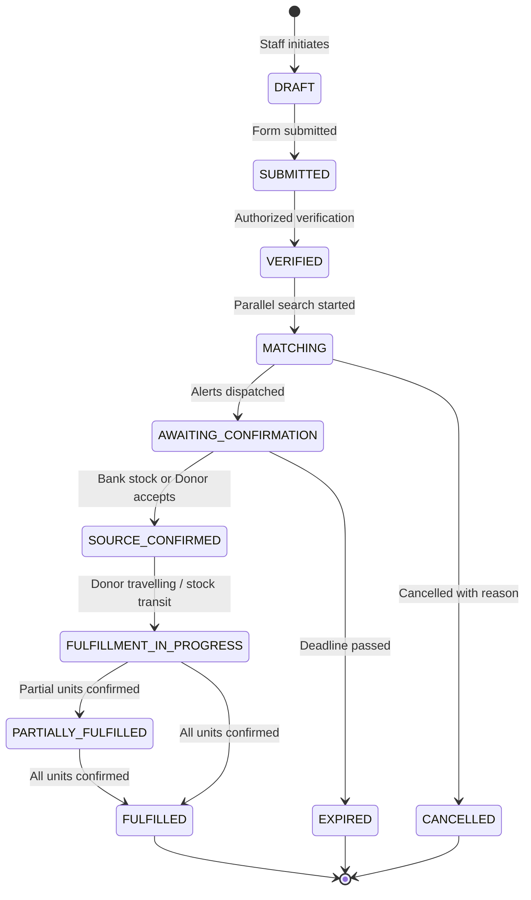

# 🩸 RaktaReach / RaktaRaksha — End-to-End User Flow & Guide

Welcome to **RaktaReach** (RescueFlow Core) — a mobile-first emergency blood coordination platform connecting verified hospitals, registered blood banks, consenting individual donors, emergency coordinators, and camp organizers into a single traceable lifecycle.

This document guides you through **how to use every part of the web application**, explaining each role, interface, decision point, and workflow step.

---

## 📑 Table of Contents
1. [Platform Architecture & Core Philosophy](#1-platform-architecture--core-philosophy)
2. [Quick Role Switcher & Demo Mode](#2-quick-role-switcher--demo-mode)
3. [User Roles & Access Permissions](#3-user-roles--access-permissions)
4. [Step-by-Step User Journeys](#4-step-by-step-user-journeys)
   - [Journey 1: Public Visitor & BloodBuddy AI Assistant](#journey-1-public-visitor--bloodbuddy-ai-assistant)
   - [Journey 2: Hospital Staff — Creating & Managing Emergency Requests](#journey-2-hospital-staff--creating--managing-emergency-requests)
   - [Journey 3: Emergency Coordinator — Escalation & Intervention](#journey-3-emergency-coordinator--escalation--intervention)
   - [Journey 4: Registered Blood Bank — Inventory & Source Confirmation](#journey-4-registered-blood-bank--inventory--source-confirmation)
   - [Journey 5: Individual Donor — Responding, Route Guidance & QR Pass](#journey-5-individual-donor--responding-route-guidance--qr-pass)
   - [Journey 6: Facility Arrival & QR Verification](#journey-6-facility-arrival--qr-verification)
   - [Journey 7: Clinical Screening, Donation Event & Request Fulfillment](#journey-7-clinical-screening-donation-event--request-fulfillment)
   - [Journey 8: Donation Camps & NGO Organizer Portal](#journey-8-donation-camps--ngo-organizer-portal)
   - [Journey 9: Interactive Live Network Map & Privacy Controls](#journey-9-interactive-live-network-map--privacy-controls)
   - [Journey 10: Platform Administrator & Audit Logs](#journey-10-platform-administrator--audit-logs)
5. [State Machine Reference (RescueFlow)](#5-state-machine-reference-rescueflow)
6. [Key Rules & Medical Boundaries](#6-key-rules--medical-boundaries)

---

## 1. Platform Architecture & Core Philosophy

RaktaReach is built on a few non-negotiable principles:
- **Parallel Source Matching**: When an emergency request is placed, the system searches both registered **Blood Banks** and **Individual Donors** concurrently so critical minutes are not wasted waiting for one before checking the other.
- **Leads vs. Fulfilled Units**: A donor accepting a notification is a **willing lead**, NOT a confirmed unit. Donors must arrive, undergo clinical screening by authorized personnel, and donate. The request status is only fulfilled when authorized staff confirm the clinical outcome.
- **Privacy by Design**:
  - The public map shows only verified facilities and camps — **never exact donor coordinates or identities**.
  - Authorized hospital staff only see aggregate/approximate distance for candidates.
  - QR arrival passes contain **only opaque, short-lived tokens**; no patient names, ABHA numbers, or medical history are stored in QR codes or public URLs.
- **Freshness-Aware Stock**: Blood bank stock displays explicit freshness labels: `Confirmed`, `Unverified`, `Stale`, `Reserved`, or `Unavailable`.

---

## 2. Quick Role Switcher & Demo Mode

For evaluation and testing without complex multi-device login, the app features a **Role Switcher & Demo Banner** at the top bar:
- **Demo Mode Badge**: `DEMO MODE ACTIVE` — All outbound SMS/FCM notifications and external API integrations are safely simulated; real donors are never pinged with test alerts.
- **One-Click Role Switch**: You can seamlessly toggle your active view between:
  1. `Hospital Staff (AIIMS Blood Center)`
  2. `Individual Donor (Rahul Sharma - O+)`
  3. `Blood Bank Staff (Red Cross Regional)`
  4. `Emergency Coordinator (State Command)`
  5. `Camp Organizer (Lions Club / NGO)`
  6. `Platform Administrator`
  7. `Public Visitor`

---

## 3. User Roles & Access Permissions

| Role | Primary Dashboard | What You Can Do | What Is Restricted |
|---|---|---|---|
| **Public Visitor** | `/` (Landing Page) | Learn myths/facts, find public camps, find verified blood banks, chat with BloodBuddy AI. | Cannot access donor list, patient case data, or emergency alerts. |
| **Hospital Staff** | `/hospital` | Create emergency blood requests (P0-P3), verify requests, view parallel match results, scan donor QR passes, log clinical screening & fulfillment. | Restricted to own verified facility scope; cannot edit other hospital requests. |
| **Individual Donor** | `/donor` | Set availability (`Available`, `Unavailable`, `Paused`), view incoming emergency alerts, Accept/Decline, view navigation route, open dynamic QR pass, view donation history. | Cannot view private details of other donors or patient medical records. |
| **Blood Bank Staff** | `/blood-bank` | Manage component inventory (PRBC, Platelets, FFP, Whole Blood), update freshness status, confirm stock for incoming hospital requests, reserve units. | Cannot access unrelated patient records or make clinical transfusion decisions. |
| **Emergency Coordinator**| `/coordinator` | Monitor high-priority (P0/P1) requests, trigger search escalation (Local $\to$ District $\to$ State), record manual telephonic interventions. | Cannot override clinical eligibility decisions or access unauthorized personal donor data. |
| **NGO / Camp Organizer** | `/organizer` | Create and publish blood donation camps, manage registrations and capacity limits, check-in donors via Camp QR scanner. | Cannot view hospital internal emergency requests. |
| **Platform Administrator**| `/admin` | Verify new hospitals/banks/NGOs, monitor data source sync health, inspect immutable audit logs, view system metrics. | No unrestricted view of restricted patient clinical notes without audited break-glass reason. |

---

## 4. Step-by-Step User Journeys

### Journey 1: Public Visitor & BloodBuddy AI Assistant
1. **Visit Landing Page** (`/`):
   - Browse the hero banner: *"Every Minute Matters. Every Donor Counts."*
   - Review verified statistics (active blood banks, verified camps).
   - Read **Blood Donation Myths & Facts** (e.g., recovery time, needle safety, tattoo deferrals).
2. **Interact with BloodBuddy Assistant**:
   - Click the floating BloodBuddy button or visit `/chatbot`.
   - Ask questions in English, Hindi, or Hinglish (e.g., *"Does donating blood cause weakness?"*, *"Tattoo ke baad blood donate kar sakte hain?"*).
   - Observe **source citations** from WHO and National Blood Transfusion Council guidelines.
   - Try asking for medical diagnosis (e.g., *"I have severe chest pain, can I donate?"*) $\to$ BloodBuddy will politely refuse medical diagnosis and instruct you to consult a physician immediately.
3. **Explore Camps & Directory**:
   - Click **Find Donation Camps** (`/camps`) to filter upcoming drives by date and city.
   - Click **Blood Bank Directory** (`/map`) to view verified blood centers and operating hours.

---

### Journey 2: Hospital Staff — Creating & Managing Emergency Requests
1. **Navigate to Hospital Command Center** (`/hospital`):
   - View the active requests dashboard showing urgency levels: `P0 (Critical/Immediate)`, `P1 (Urgent/Same Day)`, `P2 (Scheduled)`, `P3 (Routine)`.
2. **Create New Blood Request** (`/hospital/requests/new`):
   - Fill in:
     - **Pseudonymous Case Ref**: e.g., `EMERG-2026-9041` (No patient full name exposed).
     - **Blood Group & Component**: e.g., `O Negative`, `Packed Red Blood Cells (PRBC)`.
     - **Quantity Required**: e.g., `2 Units`.
     - **Urgency Level**: `P0 - Immediate Transfusion Needed`.
     - **Required By Deadline**: Set time target (e.g., within 2 hours).
     - **Destination Department**: e.g., `Trauma ICU, Bed 4`.
   - Click **Submit Request**.
3. **Parallel Matching View**:
   - The system initiates two concurrent searches:
     - **Branch A: Blood Banks**: Shows nearby banks with matching inventory, freshness label (`Confirmed`, `Stale`, `Unverified`), distance, and phone contact.
     - **Branch B: Opted-in Donors**: Shows anonymized matching candidates within radius, ranked by distance and last confirmed availability.
   - Real-time status indicators show which branch is awaiting response.

---

### Journey 3: Emergency Coordinator — Escalation & Intervention
1. **Access Coordinator Console** (`/coordinator`):
   - Displays the **P0/P1 Emergency Queue** with a countdown timer to deadline.
2. **Reviewing Stalled Requests**:
   - If a request has not received sufficient donor acceptances or stock confirmations within the designated response window, the coordinator intervenes.
3. **Trigger Search Escalation**:
   - Click **Escalate Search**:
     - Stage 1: `Local Radius (0 - 15 km)`
     - Stage 2: `Adjacent Districts (15 - 50 km)`
     - Stage 3: `Statewide Network (50+ km)`
   - Enter escalation reason (e.g., *"Rare blood group Bombay Phenotype / O- Negative unavailable locally; widening search radius"*).
   - Log manual coordination notes (e.g., *"Called District Red Cross Blood Bank directly; arranging emergency transport"*).

---

### Journey 4: Registered Blood Bank — Inventory & Source Confirmation
1. **Open Blood Bank Workspace** (`/blood-bank`):
   - Review current inventory breakdown by component:
     - Whole Blood, PRBC, Fresh Frozen Plasma (FFP), Single Donor Platelets (SDP), Random Donor Platelets (RDP).
2. **Update Inventory & Freshness**:
   - Click **Update Stock** or import CSV file.
   - Mark inventory verification status:
     - `Confirmed Available` (physically verified within last 4 hours).
     - `Stale` (older than freshness threshold).
     - `Reserved` (committed to an active emergency request).
3. **Respond to Incoming Hospital Allocation Requests**:
   - When a hospital requests stock, view the notification card in the request queue.
   - Click **Confirm Availability (Full / Partial)** or **Decline (No Stock)**.
   - If confirmed, enter the official internal Blood Bag / Segment ID reference.
   - The stock is safely moved to `Reserved` state without double-allocation risk.

---

### Journey 5: Individual Donor — Responding, Route Guidance & QR Pass
1. **Open Donor Mobile Dashboard** (`/donor`):
   - Check and toggle your status:
     - 🟢 `Available to Contact`
     - 🟡 `Temporarily Unavailable`
     - 🔴 `Pause Requests (30 Days)`
   - Set privacy consents: *Opt-in to alerts*, *Map Discoverability (approximate only)*.
2. **Receive Emergency Blood Alert**:
   - An alert card appears with high visual priority:
     - *Urgency*: `P0 Critical`
     - *Component*: `O- Packed Red Blood Cells`
     - *Hospital*: `AIIMS Trauma Center (4.2 km away)`
     - *Time Remaining*: `45 minutes`
3. **Accepting or Declining**:
   - Click **Accept Request** (or Decline if unable to attend).
   - Acceptance records your intent and provides next steps.
4. **Navigation & Route Guidance**:
   - View destination address, contact number of hospital blood center, and transit directions map.
   - Optional: Toggle **"Mark Travelling"** to update hospital staff that you are en route.
5. **Dynamic QR Donation Pass**:
   - A secure, request-specific **QR Pass** is generated on screen.
   - Notice: **No patient name or private data** is shown on the pass — only an expiring, single-use security token and your donor identifier.

---

### Journey 6: Facility Arrival & QR Verification
1. **Arrival at Blood Center**:
   - The donor presents the digital QR Pass on their phone screen.
2. **Hospital / Blood Bank Staff Scans QR**:
   - Authorized staff opens **QR Scanner** (`/hospital/scan` or `/blood-bank/scan`).
   - Uses device camera or enters the 8-character manual fallback code.
3. **Backend Validation**:
   - The backend checks:
     - $\checkmark$ Is the token valid and not expired?
     - $\checkmark$ Is it associated with this specific active request and facility?
     - $\checkmark$ Has it already been scanned/used? (prevents screenshot replay).
   - Scanner screen confirms: `Donor Arrival Verified: Rahul S. (O+)`.

---

### Journey 7: Clinical Screening, Donation Event & Request Fulfillment
1. **Authorized Clinical Screening**:
   - Clinical staff performs standard medical evaluation (Hemoglobin check, BP, donor history form).
   - Staff records screening outcome in the portal:
     - `Eligible to Proceed` $\to$ Moves donor to phlebotomy.
     - `Deferred (Temporary/Permanent)` $\to$ Donor is safely marked deferred with reason (e.g. Low Hb $< 12.5$ g/dL); request remains active for other sources.
2. **Recording Donation Event**:
   - Once phlebotomy completes, staff inputs the official facility **Blood Unit Barcode / Batch ID**.
   - Note: The donation event is linked to the request timeline for tracking, but physical blood units remain under strict blood-bank safety protocols.
3. **Request Fulfillment Reconciliation**:
   - Authorized hospital coordinator confirms whether the emergency request is:
     - `Partially Fulfilled` (e.g., 1 of 2 units received; continue search).
     - `Fully Fulfilled` (all required units secured).
   - When **Fully Fulfilled**:
     - System automatically terminates queued alerts for other donors.
     - A digital thank-you notification and certificate are issued to the donor.
     - Audit log registers complete end-to-end timeline.

---

### Journey 8: Donation Camps & NGO Organizer Portal
1. **Organizer Portal** (`/organizer`):
   - Verified NGO or community organization logs in.
2. **Create New Blood Donation Camp**:
   - Enter Camp Title, Organizing Partner, Venue Address, Map Coordinates.
   - Date & Operating Hours (e.g., *Sunday, 9:00 AM - 4:00 PM*).
   - Target Donor Capacity (e.g., *150 Donors*).
   - Supported Blood Center Partner (e.g., *Rotary Blood Bank*).
   - Click **Publish Camp**.
3. **Public Donor Registration**:
   - Donors discover the camp under `/camps`.
   - Click **Register for Camp** $\to$ Generates a Camp Check-in QR.
   - Real-time capacity counter increments safely.
4. **On-Site Camp Check-in**:
   - Organizer scans attendees' Camp QR codes at the registration desk to record turnout.

---

### Journey 9: Interactive Live Network Map & Privacy Controls
1. **Explore Live Map** (`/map`):
   - **Public View**:
     - Displays red pins for verified **Blood Banks**.
     - Displays blue pins for verified **Hospitals**.
     - Displays green pins for scheduled **Donation Camps**.
     - Shows address, verified status, operating hours, and public helpline.
   - **Authorized Staff / Coordinator View**:
     - Enables the **Donor Availability Layer**: displays approximate, clustered density heatmaps of opted-in donors.
     - Exact live GPS positions and personal contact information are strictly concealed.
2. **Filter Controls**:
   - Filter by blood group requirement (`A+`, `A-`, `B+`, `B-`, `AB+`, `AB-`, `O+`, `O-`).
   - Filter by component (`Whole Blood`, `PRBC`, `Platelets`, `Plasma`).
   - Filter by distance radius (`5 km`, `15 km`, `50 km`, `All`).

---

### Journey 10: Platform Administrator & Audit Logs
1. **Admin Console** (`/admin`):
   - **Organization Verification Queue**: Review submitted applications from hospitals, blood banks, and NGOs; inspect uploaded licenses; Approve or Reject.
   - **Data Source Health**: Monitor sync status of external directories, imported CSVs, or connected feeds (provenance, last sync timestamp, records imported, error counts).
   - **Append-Only Audit Log Viewer**:
     - Every state change, request creation, match run, QR scan, screening outcome, and fulfillment confirmation is recorded with Actor ID, Timestamp, Action, Previous State, and New State.
     - Tamper-proof trail for healthcare governance.

---

## 5. State Machine Reference (RescueFlow)

### Donor Response Lifecycle
`MATCHED` $\to$ `NOTIFIED` $\to$ `ACCEPTED` $\to$ `TRAVELLING` $\to$ `ARRIVED_QR_VERIFIED` $\to$ `SCREENING_IN_PROGRESS` $\to$ `DONATION_RECORDED` $\to$ `DONATION_VERIFIED` *(or `DEFERRED` at screening)*.

---

## 6. Key Rules & Medical Boundaries

1. **RaktaReach coordinates; medical staff certify.** The software never certifies biological compatibility or makes transfusion decisions.
2. **A donor acceptance is a lead, not inventory.** No units are marked fulfilled until hospital clinical staff complete official screening and donation.
3. **No raw personal health identifiers (PHI) or ABHA in QR codes.** Tokens are short-lived, unguessable, and validated exclusively against backend records.
4. **Demo mode transparency.** Synthetic test data is always explicitly marked as such; real donors are never contacted by simulated runs.

---

*Document prepared for RaktaReach / RaktaRaksha. Refer to `docs/architecture.md` for technical API and database specifications.*
